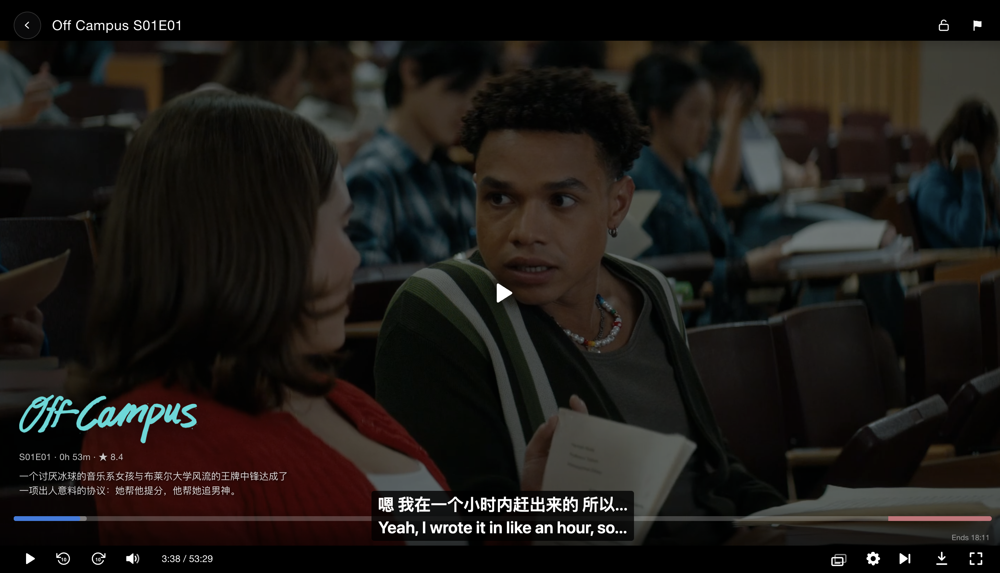
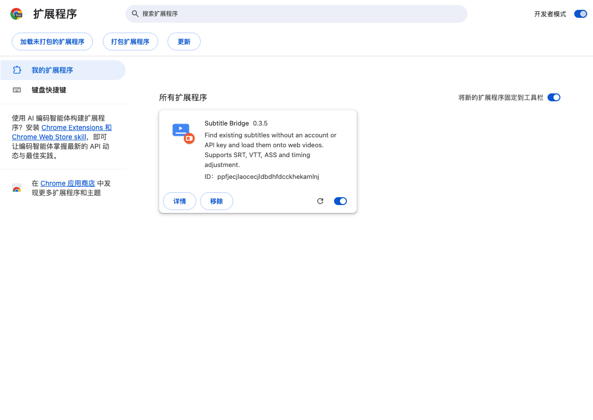
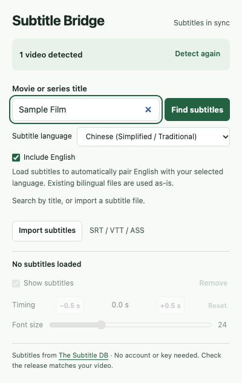
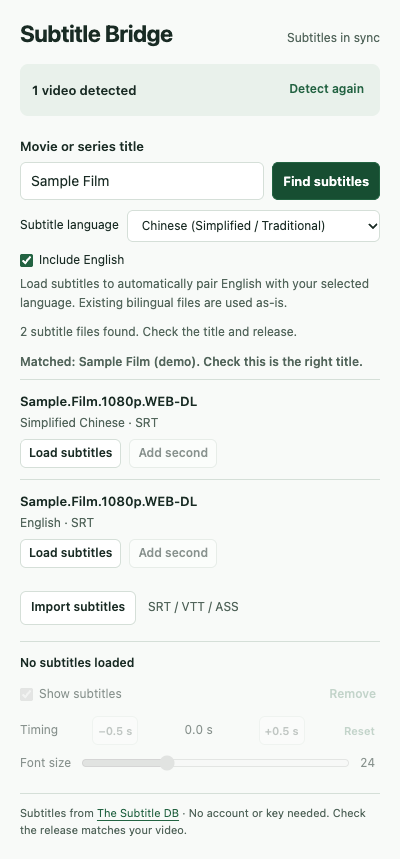
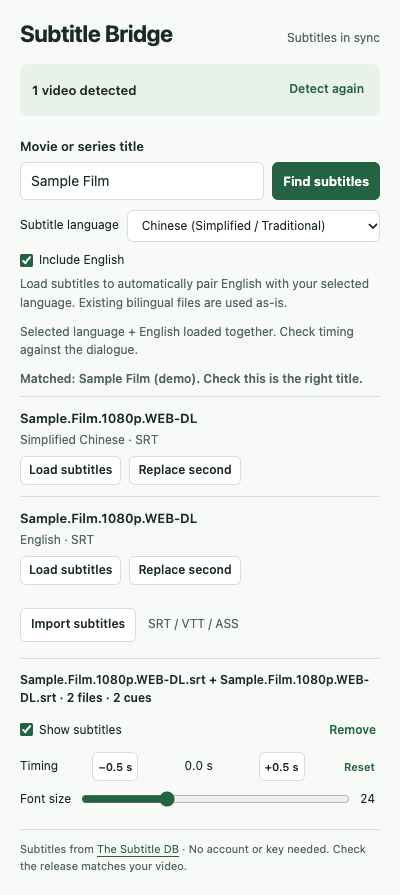

# Subtitle Bridge

**Bring existing subtitles to the video you are already watching.**

A small Chrome / Microsoft Edge extension for finding and loading subtitles onto web videos. Search by movie or episode, import your own file, and optionally watch your chosen language alongside English—all from one toolbar popup.

**No subtitle-site account. No API key. No server to run.**

English · [简体中文](README.zh-CN.md)

[Download the latest version](https://github.com/tangnanxi/subtitle-bridge/releases/latest) · [Install](#1-install-the-extension) · [Watch with subtitles](#2-find-subtitles-for-your-video) · [Troubleshooting](#troubleshooting)



*Real playback example: Chinese and English subtitles shown together in Off Campus S01E01. The installation and popup walkthrough below uses a synthetic video and clearly labeled sample search results. Subtitle availability and timing depend on the selected release.*

## What it does

| Feature | How it helps |
| --- | --- |
| Search existing subtitles | Look up a movie, an episode such as `Series title S01E01`, or an IMDb ID. |
| Include English | Pair the selected language with an English subtitle file when a compatible file is available. |
| Import your own subtitles | Load an unpacked `.srt`, `.vtt`, `.ass`, or `.ssa` file. |
| Follow playback | Subtitles follow the video's playback time, including pauses and seeking. |
| Adjust timing and size | Move subtitles earlier or later in 0.5-second steps and choose a readable font size. |
| Keep the interface small | Use a toolbar popup; close it and continue watching. |

Subtitle Bridge loads existing subtitle text. It does **not** transcribe audio, translate missing languages, or provide movies.

## 1. Install the extension

You do not need to install Node.js, run commands, or start a service.

1. Open [Releases](https://github.com/tangnanxi/subtitle-bridge/releases/latest) and download **`subtitle-bridge-chrome-edge-v0.3.5.zip`** from **Assets**.
2. Extract the ZIP. Find the **`subtitle-bridge`** folder containing **`manifest.json`**.
3. Open the extension-management page for your browser:

   | Browser | Address |
   | --- | --- |
   | Google Chrome | `chrome://extensions` |
   | Microsoft Edge | `edge://extensions` |

4. Turn on **Developer mode**, then click **Load unpacked**.
5. Select the extracted **`subtitle-bridge`** folder. Select the folder itself, not the ZIP or `manifest.json`.
6. Open your browser's extensions menu and pin **Subtitle Bridge** for easy access.



*The browser in this screenshot uses Chinese labels: 开发者模式 = Developer mode; 加载未打包的扩展程序 = Load unpacked. The extension popup itself is in English.*

You can also download this repository using **Code → Download ZIP**. In that case, load the extracted repository folder containing `manifest.json`.

### Updating an existing installation

Replace the contents of the folder you originally loaded with the new version, then click **Reload** on the extension's card. Keep that folder in place: unpacked extensions read their files from it. Enable only one copy of Subtitle Bridge. If an already-open movie page retains old behavior, refresh it and load the subtitles again.

## 2. Find subtitles for your video

1. Open a normal video webpage and **start the video**.
2. Click the blue **Subtitle Bridge** icon in your browser toolbar.
3. Check for **`1 video detected`**. If the page contains several videos, choose the one you are watching.
4. Enter a movie title or a series title with its episode number.
5. Choose **Subtitle language**, then click **Find subtitles**.

| What you are watching | Example query |
| --- | --- |
| A movie | `The Matrix` |
| A series episode | `Off Campus S01E01` |
| A title that matches incorrectly | `tt0133093` |



The **Matched** line identifies the title returned by the subtitle source. Check it before loading. If it is wrong, try the original title, add a release year, or use the IMDb ID. The source matches one title per lookup; this popup is not a list of every film with a similar name.

## 3. Choose a file and load it

1. Check the result's language and release name.
2. Prefer a release that matches your video, such as the same WEB-DL / BluRay source or release group.
3. Click **Load subtitles** on that result.
4. Wait for a success message, then close the popup and keep watching.



### Watch with your language + English

Keep **Include English** checked before searching and loading. It is a single option that works with Chinese, Japanese, or Korean; there is no separate “Chinese + English” language entry.

- Files whose names suggest bilingual subtitles appear first.
- If the selected file already contains bilingual dialogue, the extension uses that file without adding another English file.
- Otherwise, **Load subtitles** tries to pair and load English automatically. The loaded-files section shows **`2 files`** when both are attached.
- If no compatible English file can be found or downloaded, your selected file still loads and the popup explains the English failure.
- To choose a second file yourself, load the first file, then click **Add second** on another result. **Replace second** swaps that second file while keeping the first.

English pairing checks release information, frame rate when provided, and subtitle duration. It is a best-effort match—not automatic synchronization of different cuts. **Both files share the same timing offset.**

Uncheck **Include English** for a single selected-language file. When **English** or **All languages** is selected, the checkbox is disabled; choose the appropriate result from the list.

## 4. Make subtitles comfortable to watch

Reopen the popup whenever you need these controls:



| Control | What to do |
| --- | --- |
| **Show subtitles** | Hide or show the currently loaded subtitles. |
| **−0.5 s** | Make subtitles appear earlier. Use this if they arrive after the spoken words. |
| **+0.5 s** | Make subtitles appear later. Use this if they appear before the spoken words. |
| **Reset** | Return the timing offset to zero. |
| **Font size** | Drag the slider to change text size. |
| **Remove** | Remove the subtitles loaded by Subtitle Bridge. |

A constant delay is usually fixable with these controls. If the gap grows throughout the movie, try a different subtitle release: a fixed offset cannot correct frame-rate drift or different edits.

## Already have a subtitle file?

Start the webpage's video, open Subtitle Bridge, and click **Import subtitles**. Choose an unpacked **SRT, VTT, ASS, or SSA** file. Timing, size, visibility, and fullscreen behavior work the same way as for a downloaded file.

ASS / SSA dialogue is displayed as plain subtitle text; typesetting, animated effects, and drawings are not reproduced. Extract ZIP / RAR / 7z archives before importing. LRC is not currently supported.

## Troubleshooting

| What you see | What to try |
| --- | --- |
| No video detected | Start playback, open the popup again, and click **Detect again**. Browser settings pages, the extension store, and other protected pages cannot host injected subtitles. |
| A video is embedded from another site | If offered, click **Enable embedded players** and review the browser's additional website-access prompt. Then detect again. |
| No subtitles found | Check the matched title, use the original title or IMDb ID, and include `S01E01` for an episode. Try another language or import a local file. The source may not have your requested language. |
| Only one language appears | Confirm **Include English** was checked when loading and read the status message. Look for **`2 files`**, or manually use **Add second** on a suitable English result. |
| Subtitles loaded but nothing appears yet | Play a section with dialogue, check **Show subtitles**, choose the right detected video, and check the timing offset. The file may have a long opening gap or be for a different cut. |
| Two subtitle layers overlap | Keep only one copy of the extension enabled. Turn off any separate caption overlay provided by the website or another extension. After updating, refresh the video page and reload your subtitles if needed. |
| Subtitles vanish after changing episodes or sources | Click **Detect again** and load the subtitle file for the new video. |
| Fullscreen does not show subtitles | Try the webpage player's fullscreen button. Compatibility depends on how the player implements fullscreen. Standard video fullscreen and player-container fullscreen are handled differently. |
| Search or download fails | Retry later, choose another result, or import a file. The third-party subtitle service may be unavailable or rate-limited. |

## Compatibility and limits

- Built for standard HTML `<video>` elements on HTTP / HTTPS webpages. Chrome 120+ is required by the manifest; current Chromium-based Edge can load the same unpacked extension.
- Chrome has been exercised with imports, dual-language loading, pause / seek behavior, timing, visibility, fullscreen, and embedded same-origin video. Edge and every streaming website have not been individually verified.
- Custom players, closed shadow roots, cross-origin frames, and browser restrictions can affect detection or display. Universal website support is not guaranteed.
- Refreshing a page or changing its video source can require loading subtitles again. Cross-device subtitle synchronization and a subtitle history library are not included.
- Subtitle availability and release labels depend on [The Subtitle DB](https://thesubtitledb.org/). Automatic matching can be wrong, so check the title and dialogue timing.

## Privacy and permissions

Searches send your title / IMDb ID, episode information when supplied, requested languages, and an extension client/version identifier to **The Subtitle DB**. Subtitle downloads also contact that service. The extension does not send video audio or video files, and requires no subtitle-site login or API key.

Language, English-pairing, and font-size preferences are stored locally. Loaded subtitle text is held for the current page. Use **Remove**, or close / refresh the page, to clear the current attachment.

| Permission | Purpose |
| --- | --- |
| `activeTab` | Access the current tab when you open the extension. |
| `scripting` | Detect video and inject the subtitle renderer. |
| `storage` | Save local preferences. |
| `https://*.thesubtitledb.org/*` | Search and download subtitles. |
| Optional HTTP / HTTPS site access | Support cross-site embedded players after you explicitly request it. This is broad access; grant it only if you need that feature. |

## For contributors

The extension is plain JavaScript, HTML, and CSS with a Manifest V3 popup. No build step is required to load it.

| File | Responsibility |
| --- | --- |
| `popup.html`, `popup.css`, `popup.js` | Search, import, video selection, and display controls. |
| `provider.js` | The Subtitle DB lookup and download handling. |
| `subtitles.js` | Subtitle parsing, decoding, and English-pairing helpers. |
| `content.js` | Playback synchronization, overlays, fullscreen, and cleanup. |

Run the parser and provider tests with Node.js 20+:

```sh
node --test tests/core.test.cjs
```

If a site fails, [open an issue](https://github.com/tangnanxi/subtitle-bridge/issues) with your browser version, extension version, playback page when shareable, subtitle format / release name, and steps to reproduce. Avoid sharing passwords, cookies, private video links, or files you do not have permission to redistribute.

Subtitle search is powered by [The Subtitle DB](https://thesubtitledb.org/) and its [integration API](https://github.com/thesubtitledb/subtitledb-integrations). Subtitle Bridge is an independent extension.
