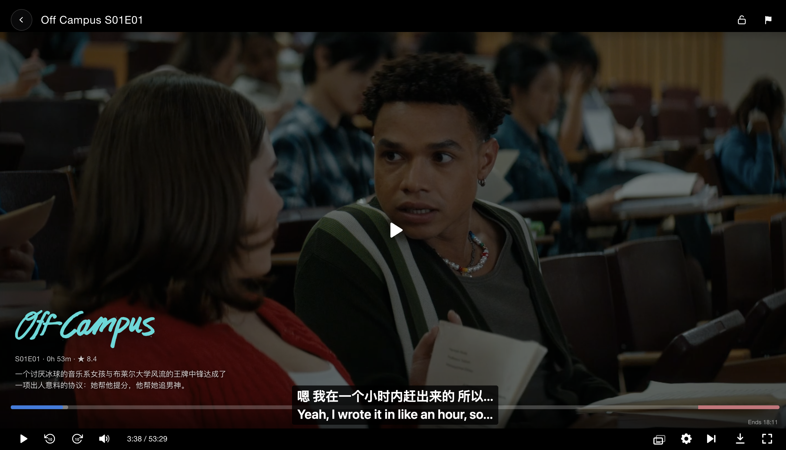
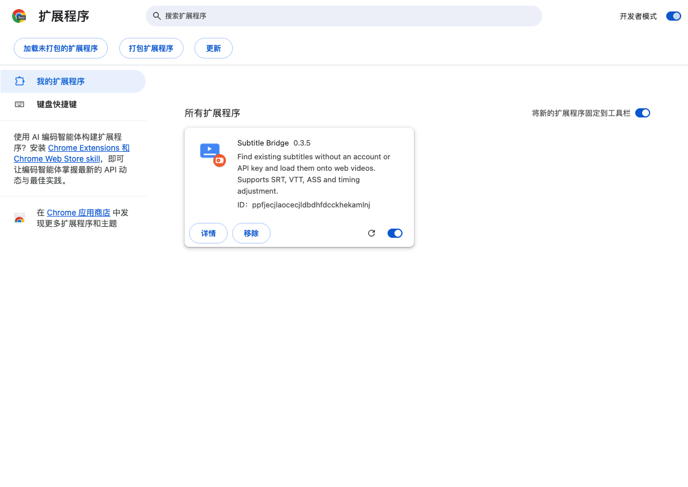
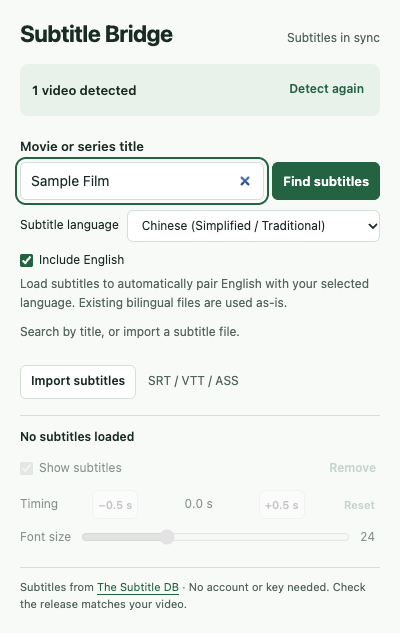
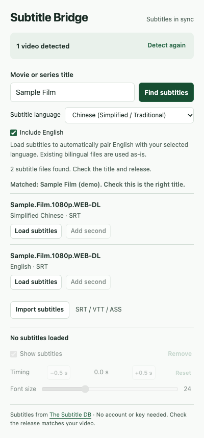
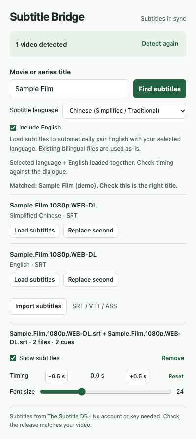

# Subtitle Bridge · 字幕桥

**给正在播放的网页视频，加上你想看的字幕。**

一个用于 Chrome / Microsoft Edge 的轻量扩展。输入电影名或剧集名称，查找现成字幕并加载到网页视频；也能导入本地文件，或同时显示所选语言与英语。所有操作都在工具栏弹窗里完成。

**无需字幕网站账号，无需 Token / API Key，无需搭建服务器。**

[English](README.md) · 简体中文

[下载最新版](https://github.com/tangnanxi/subtitle-bridge/releases/latest) · [安装教程](#一安装插件) · [开始使用](#二打开视频查找字幕) · [常见问题](#常见问题)



*实际播放示例：在 Off Campus S01E01 中同时显示中文和英语字幕。下方安装与弹窗教程使用自制演示视频及明确标注的示例搜索结果；具体字幕资源和同步效果取决于所选版本。*

## 能做什么

| 功能 | 用法 |
| --- | --- |
| 搜索现成字幕 | 输入电影名、`剧名 S01E01`，或 IMDb 编号。 |
| 双语观看 | 勾选 **Include English**，加载主语言时尝试自动配上英文。 |
| 导入本地字幕 | 支持解压后的 SRT、VTT、ASS、SSA 文件。 |
| 跟随视频 | 播放、暂停、快进后，字幕跟随视频时间。 |
| 调整时间与字号 | 每次提前 / 延后 0.5 秒，也能调整文字大小。 |
| 关闭弹窗继续看 | 加载后不需要一直开着插件弹窗。 |

插件使用的是**已有字幕**，不做语音识别或机器翻译，也不提供电影播放资源。

## 字幕语言

提供 **28 个语言选项**：中文、英语、西班牙语、葡萄牙语、法语、德语、意大利语、日语、韩语、俄语、乌克兰语、阿拉伯语、印地语、印尼语、马来语、越南语、泰语、土耳其语、荷兰语、波兰语、瑞典语、丹麦语、挪威语、芬兰语、希腊语、希伯来语、波斯语和罗马尼亚语，并保留 **All languages**。

选择西班牙语时会同时查询通用、西班牙和拉美版本；葡萄牙语同时查询葡萄牙语和巴西版本。所有非英语选项均可勾选 **Include English**，语言偏好会保存在本机。是否有字幕文件仍取决于字幕源。

## 一、安装插件

安装时不需要写代码、安装 Node.js 或运行任何服务。

1. 打开 [Releases 下载页](https://github.com/tangnanxi/subtitle-bridge/releases/latest)。
2. 在 **Assets** 里下载 **`subtitle-bridge-chrome-edge-v0.3.6.zip`**，然后解压。
3. 找到解压后的 **`subtitle-bridge`** 文件夹，里面应该能看到 **`manifest.json`**。
4. 在浏览器地址栏打开对应的扩展管理页：

   | 浏览器 | 地址 |
   | --- | --- |
   | Chrome | `chrome://extensions` |
   | Microsoft Edge | `edge://extensions` |

5. 打开右上角的 **开发者模式**，点击 **加载未打包的扩展程序 / 加载解压缩的扩展**。
6. 选择刚才的 **`subtitle-bridge` 文件夹**。选择整个文件夹，不是 ZIP 或 `manifest.json` 文件。
7. 在浏览器右上角的扩展菜单中，将 **Subtitle Bridge** 固定到工具栏，之后点击蓝色图标即可使用。



也可以在仓库首页点击 **Code → Download ZIP**。这种方式解压后，选择包含 `manifest.json` 的仓库文件夹即可。

### 已经装过，怎么更新？

用新版本替换原来安装文件夹里的内容，再到扩展管理页点击该插件的 **重新加载**。不要删除原文件夹，也不要同时启用两份字幕桥。如果已经打开的电影页面仍有旧版行为，刷新该页面后重新加载字幕。

## 二、打开视频，查找字幕

1. 打开普通视频网站，**先开始播放视频**。
2. 点击工具栏里的 **Subtitle Bridge** 蓝色图标。
3. 顶部出现 **`1 video detected`**，表示检测到一个视频。有多个视频时，选择你正在观看的那个。
4. 在 **Movie or series title** 中输入片名。
5. 在 **Subtitle language** 中选择字幕语言，点击 **Find subtitles**。

| 要找什么 | 输入示例 |
| --- | --- |
| 电影 | `The Matrix` |
| 剧集的指定一集 | `Off Campus S01E01` |
| 同名电影匹配错误时 | `tt0133093`，即 IMDb 编号 |



结果中的 **Matched** 表示字幕源匹配到的影片。先确认片名和年份是否正确；如果不对，换用原始片名、补充年份，或输入 IMDb 编号。字幕源每次返回一个匹配影片，不是所有同名电影的候选列表。

## 三、选择字幕，一键加载

1. 查看结果中的字幕语言和版本名称。
2. 优先选择与你的视频一致的版本，例如相同的 WEB-DL / BluRay 片源或发布组。
3. 点击该结果下的 **Load subtitles**。
4. 等待加载成功，关闭弹窗，继续观看。



### 想同时看中文和英文，怎么设置？

在 **Subtitle language** 里选择中文，并保持 **Include English** 勾选，再搜索和加载。西班牙语、葡萄牙语、日语、韩语等也可以使用同一个勾选框。

- 文件名提示有双语的字幕会优先显示。
- 如果识别到所选文件本身已有双语对白，插件会直接使用这一份，不再重复添加英文。
- 如果所选文件只有主语言，点击 **Load subtitles** 后会尝试自动配对英文，一起加载。
- 底部显示 **`2 files`**，说明当前加载了两份字幕文件。
- 如果没有找到兼容的英文，或英文下载失败，主语言仍然保留，弹窗会说明原因。
- 想手动选第二份文件时，先加载第一份，再点另一条结果的 **Add second**；**Replace second** 用来替换第二份。

自动配对会参考发布版本、可用的帧率信息和字幕总时长，但不保证不同剪辑一定同步。**两份字幕共用同一个时间偏移，暂不支持分别校准。**

只看一种语言时，取消勾选 **Include English** 即可。如果主语言已选英语或全部语言，这个勾选框会禁用，请从结果中选择需要的文件。

## 四、字幕快了、慢了，或者太小？

重新打开插件弹窗，在底部调整：



| 控件 | 作用 |
| --- | --- |
| **Show subtitles** | 勾选显示字幕，取消勾选暂时隐藏。 |
| **−0.5 s** | 让字幕提前出现。听到对白后字幕才出来时，用这个。 |
| **+0.5 s** | 让字幕延后出现。还没说话字幕就出来时，用这个。 |
| **Reset** | 将时间偏移恢复到 0。 |
| **Font size** | 拖动滑块调整字号。 |
| **Remove** | 移除当前由字幕桥加载的字幕。 |

如果字幕始终固定快或慢几秒，通常可以这样修正。如果越看偏差越大，可能是帧率或剪辑版本不同，需要换一份字幕，固定偏移无法修复持续漂移。

## 五、有本地字幕文件，直接导入

先开始播放视频，再打开插件，点击 **Import subtitles**，选择已经解压的 **SRT、VTT、ASS 或 SSA** 文件。导入后，同样可以调整时间、字号和显示状态。

ASS / SSA 目前只显示对白文本，不还原花字、动画或绘图。ZIP / RAR / 7z 文件请先解压。暂不支持 LRC。

## 常见问题

| 问题 | 解决方式 |
| --- | --- |
| 检测不到视频 | 先开始播放，重新打开弹窗，再点 **Detect again**。浏览器设置页、扩展商店等受保护页面无法挂载字幕。 |
| 播放器嵌在另一个网站里 | 如果出现 **Enable embedded players**，点击并阅读浏览器额外网站访问权限提示，授权后重新检测。 |
| 搜不到字幕 | 核对 Matched；换用原始片名或 IMDb 编号；剧集补上 `S01E01`；尝试其他语言或导入文件。字幕库不保证每部影片、每种语言都有资源。 |
| 勾选了英语，但只看到中文 | 确认加载时 **Include English** 已勾选，并查看状态提示和是否显示 **`2 files`**。也可以手动在合适的英文结果上点 **Add second**。 |
| 提示加载了，画面却没有字幕 | 播放到有对白的片段，检查 **Show subtitles**、选择的视频和时间偏移。字幕可能有片头空白，也可能对应不同剪辑。 |
| 字幕重叠 | 只启用一份字幕桥，关闭网站或其他插件额外绘制的字幕。更新后如果仍有旧字幕残留，刷新视频页面并重新加载。 |
| 换集或换片源后字幕没了 | 点 **Detect again**，再加载新视频对应的字幕。 |
| 全屏后没有字幕 | 尝试播放器自己的全屏按钮。兼容性取决于网站如何实现全屏；视频原生全屏与播放器容器全屏使用不同的显示方式。 |
| 搜索或下载报错 | 稍后重试、换另一份结果，或导入本地文件；第三方字幕服务可能暂时不可用或限流。 |

## 兼容范围与限制

- 面向普通 HTTP / HTTPS 网页中的标准 HTML `<video>` 播放器。清单要求 Chrome 120+；使用 Chromium 的现代 Edge 可加载同一份扩展。
- 已在 Chrome 中验证导入、双语加载、暂停 / 快进、时间校准、显示开关、全屏及同源嵌入视频。Edge 和所有视频网站尚未逐项实机验证。
- 自定义播放器、封闭 Shadow DOM、跨域 iframe 和浏览器限制都可能影响检测或显示，不承诺兼容所有网站。
- 刷新网页、换集或换片源后，可能需要重新加载。暂不包含跨设备同步或字幕历史库。
- 字幕资源与语言标签来自 [The Subtitle DB](https://thesubtitledb.org/)，自动匹配也可能出错，请核对影片和对白时间。

## 隐私与权限

搜索时，片名 / IMDb 编号、提供的集数、请求语言和插件版本标识会发送给 **The Subtitle DB**；下载字幕也会访问该服务。插件不上传视频音频或电影文件，不要求字幕网站登录凭据或密钥。

语言、是否配英文和字号偏好保存在本机。加载的字幕用于当前网页；点击 **Remove**、关闭或刷新页面后，会清除当前挂载。

| 权限 | 用途 |
| --- | --- |
| `activeTab` | 你打开插件时访问当前标签页。 |
| `scripting` | 检测视频并挂载字幕显示层。 |
| `storage` | 保存本地偏好。 |
| `https://*.thesubtitledb.org/*` | 查找和下载现成字幕。 |
| 可选的 HTTP / HTTPS 网站访问权限 | 在你主动启用跨域嵌入播放器时使用。这是较广的网站访问范围，仅在需要时授权。 |

## 参与改进

项目使用 Manifest V3 和原生 JavaScript / HTML / CSS，无需构建即可加载。核心文件：

| 文件 | 作用 |
| --- | --- |
| `popup.html` / `popup.css` / `popup.js` | 弹窗、搜索、导入与字幕控制。 |
| `provider.js` | 字幕源搜索与下载。 |
| `subtitles.js` | 字幕解析、解码和英文配对。 |
| `content.js` | 同步、显示层、全屏与清理。 |

开发者可用 Node.js 20+ 运行解析与接口测试：

```sh
node --test tests/core.test.cjs
```

遇到兼容问题，可以 [提交 Issue](https://github.com/tangnanxi/subtitle-bridge/issues)，附上浏览器版本、插件版本、可公开的播放页面、字幕格式 / 版本名称和复现步骤。请不要提交密码、Cookie、私密播放链接或无权分发的文件。

字幕搜索由 [The Subtitle DB](https://thesubtitledb.org/) 及其 [公开集成接口](https://github.com/thesubtitledb/subtitledb-integrations)提供。Subtitle Bridge 是独立扩展。
